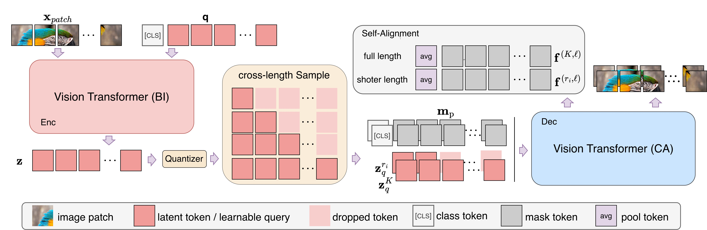

# NesTok: Nested Self-Aligned 1D Tokenizer for Autoregressive Image Generation

📎 [Nested Self-Aligned 1D Tokenizer for Autoregressive Image Generation](https://arxiv.org/abs/2609.36756)

<p align="center">
     <br />
    <em> 
    </em>
</p>


## Abstract <a name="2"></a> 
One-dimensional (1D) variable-length visual tokenizers enable adaptive compression by varying the number of tokens, allowing downstream autoregressive (AR) models to flexibly trade off generation quality against computational cost using a single tokenizer. However, existing approaches based on nested dropout often fail to fully exploit the representational capacity of the tokenizer, resulting in suboptimal performance in both image reconstruction and generation. In this work, we introduce NesTok, a nested self-alignment framework tailored to dynamic visual tokenizers. NesTok introduces cross-length training, which jointly optimizes reconstruction across token lengths while using the full-length sequence to guide shorter counterparts, enabling shorter token sequences to approach the reconstruction quality of full-length sequences. On ImageNet, NesTok improves substantially over standard training and achieves an rFID score of 0.98. On downstream image generation, it achieves the state-of-the-art gFID score of $\textbf{1.46}$ on ImageNet 256 $\times$ 256 among existing variable-length autoregressive image generation methods.


<p align="center">
     <br />
    <em> 
    </em>
</p>


## Citation
If you use our code for your paper, please cite:

```bibtex
@article{zhang2026nestok,
      title={NesTok: Nested Self-Aligned 1D Tokenizer for Autoregressive Image Generation}, 
      author={Jiawei Zhang and Shuhao Liu and Rong Huang and Yuancheng Li and Zhihui Li and Xiaojun Chang and Changlin Li},
      journal={arXiv preprint arXiv:2609.36756},
      year={2026}
}
```

## License
This project is under the MIT license. See [LICENSE](LICENSE.txt) for details.
